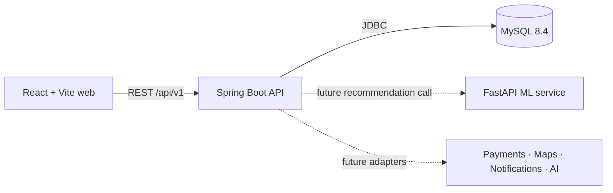

# RideNexa foundation architecture

Phase 1 provides a real cross-origin frontend-to-backend health request, a MySQL-backed public API health endpoint, and an independently runnable FastAPI health endpoint. Authoritative business rules will remain in Spring Boot; the ML service will only rank eligible candidates supplied by the API.
